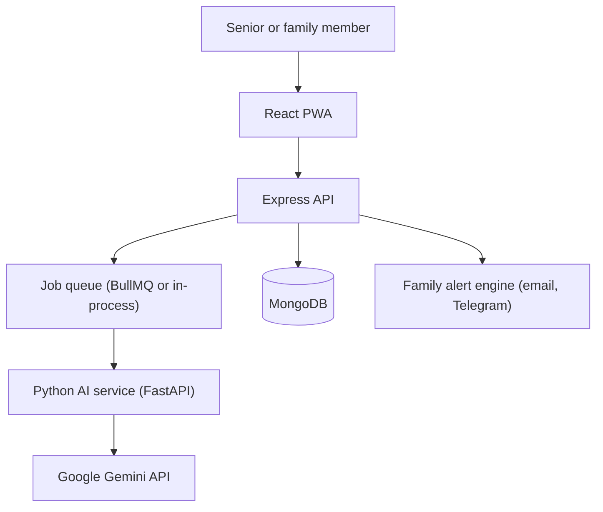

# Digital Pusher

**Pushing back against digital manipulation.**
An AI guardian that helps people, especially seniors, spot scams, understand the trick in plain language, and get a trusted family member involved before they act.

Built for the Google Gemini Hackathon by **Team Mutant Coders**.

---

## The problem
Scams use urgency, fake authority, fear and secrecy ("don't tell anyone") to push people into decisions before they can think. Existing tools block known numbers or links, but they rarely explain *why* something is a scam, in the person's own language, or bring the family in at the right time.

## What Digital Pusher does
Seniors (or their families) send a suspicious message, voice note, screenshot or document. Digital Pusher returns a plain-language verdict in English or Hindi, shows the manipulation tactics with quoted evidence, gives safe next steps, and can alert a trusted family member.

### Three modes, one pipeline
**Scam Guardian**: text, voice notes, call recordings and screenshots.
- Detects pressure tactics: urgency, authority impersonation, fear, secrecy and payment demands.
- Quotes the exact phrases as evidence.
- Gives spoken explanations and an independent verification checklist.

**Dark Pattern Auditor**: checkout and cancellation flows.
- Flags patterns such as drip pricing, sneak-into-basket, confirm shaming and hard-to-cancel flows, with explanations and draft complaints.
- Categories are inspired by India's CCPA dark-pattern guidelines and are marked *needs verification* against the official text.

**Paperwork Decoder**: legal notices, agreements and official letters.
- Plain-language summaries, risky-clause flags and extracted deadlines.

### Family Shield
- The senior invites a trusted contact, and the contact must be accepted. The senior can revoke at any time.
- Alerts fire automatically above the senior's chosen risk threshold, with a 10-minute dedupe and a cap of 3 alerts per hour.
- Alerts are sent by email and Telegram, and appear on the family dashboard.

## Feature status
| Feature | Status |
|---|---|
| Auth, roles, senior-to-family consent linking | Done |
| AI service: grounding, PII masking, policy engine, speech output | Done |
| Submission pipeline, encrypted storage, queue, polling | Done |
| Scam result screen, audio recorder, file upload | Done |
| Family alerts (email, Telegram outbound) and dashboard | Done |
| Auto-delete job and delete-my-data | Done |
| Demo seed and reset scripts | Done |
| AI cache, retry and model fallback | Done |
| Dark-pattern and paperwork backend pipelines | Done, shown in the shared result layout |
| Dedicated dark-pattern and paperwork screens | Next |
| Two-way Telegram bot, WhatsApp alerts | Next |
| Link and website risk check, browser extension | Next |
| CI pipeline and secret scanning | Next |

## How it works


The AI service masks personal data, retrieves grounding from a curated scam and dark-pattern knowledge base, asks Gemini for structured JSON, applies deterministic policy rules (risk, escalation, disclaimers), and generates a spoken explanation.

## Where Gemini is used
- **Multimodal understanding** of text, screenshots, documents and audio.
- **Structured output:** every analysis is a typed JSON contract that drives the UI and alerts.
- **Multilingual reasoning:** English and Hindi explanations.
- **Grounded explanations** tied to a curated pattern library.
- **Fast and strong model split**, with model IDs set through environment variables so they can be changed without code changes.

## Responsible AI and privacy
- **Consent first:** family sharing is opt-in, revocable and summary-only by default.
- **PII masking:** phone, card, Aadhaar-like numbers and emails become placeholders such as `[PHONE_1]` before storage or any model call.
- **Encrypted storage:** uploaded media is encrypted at rest with AES-256-GCM.
- **Auto-delete:** media older than the retention period is removed, and users can delete all their data.
- **False-positive guardrails:** genuine bank OTP messages are tested and protected from false flags.
- **Honest uncertainty:** low-confidence or high-stakes cases return "unclear" and escalate to human help.
- **Prompt-injection defense:** user content is treated as untrusted data.
- **No overclaiming:** it flags behavioural tactics only. It does not claim to detect deepfake or cloned voices.
- **Information, not advice:** legal output is general information, not legal advice.

## Evaluation
Measured on our own adversarial test set of 65 cases (digital-arrest scams, loan-app scams, genuine bank OTPs, dark-pattern flows and prompt-injection attempts).

| Metric | Result |
|---|---|
| Overall classification accuracy | 86.2% |
| False-positive rate on genuine bank alerts | 0.0% |
| Prompt-injection defense | 100% |

> These figures come from our own small, partly synthetic test set, so treat them as indicative, not as production accuracy. Method and data are in `services/ai/eval/`.

## Tech stack
| Tier | Technologies |
|---|---|
| AI service | Python, FastAPI, Pydantic, Google Gemini API (`google-genai`), Edge-TTS |
| Backend | Node.js, Express, TypeScript, Mongoose, Zod, Multer, BullMQ with in-process fallback |
| Frontend | React, Vite, TypeScript, Tailwind CSS, TanStack Query, i18next (English and Hindi) |
| Security | AES-256-GCM, JWT in httpOnly cookies, Helmet, rate limiting |
| Testing | Vitest, Supertest, Pytest |

## Repository structure
```text
digital-pusher/
├── apps/
│   ├── api/        Express REST API (auth, consent, submissions, alerts, jobs)
│   └── web/        React PWA
├── services/
│   └── ai/         FastAPI Gemini analysis service, knowledge base, eval suite
├── contract/       JSON schema shared by the API and AI service
└── README.md
```

## Getting started

### Prerequisites
Node.js 20+, Python 3.11+, a MongoDB database, and a Gemini API key from [Google AI Studio](https://aistudio.google.com/).

### Install
```bash
git clone https://github.com/<your-username>/digital-pusher.git
cd digital-pusher
npm install

cd services/ai
python -m venv .venv
# Windows:  .\.venv\Scripts\activate
# macOS/Linux:  source .venv/bin/activate
pip install -r requirements.txt
cd ../..
```

### Configure
Create `apps/api/.env`:
```env
PORT=4000
NODE_ENV=development
MONGODB_URI=<your MongoDB connection string>
JWT_SECRET=<long random string>
STORAGE_ENCRYPTION_KEY=<64 hex characters, generate your own>
AI_SERVICE_URL=http://127.0.0.1:5001
CORS_ORIGIN=http://localhost:3000
```

Create `services/ai/.env`:
```env
PORT=5001
HOST=0.0.0.0
GEMINI_API_KEY=<your Gemini API key>
GEMINI_FAST_MODEL=<model id from Google AI Studio>
GEMINI_STRONG_MODEL=<model id from Google AI Studio>
GEMINI_EMBED_MODEL=<embedding model id>
```
Never commit `.env` files. Generate your own secrets, for example with `openssl rand -hex 32`.

### Run (three terminals)
```bash
# 1. AI service
cd services/ai
.venv/Scripts/uvicorn app.main:app --host 0.0.0.0 --port 5001   # Windows
# uvicorn app.main:app --host 0.0.0.0 --port 5001               # macOS/Linux with the venv active

# 2. API
npm run dev:api

# 3. Web app
npm run dev:web
```
Open http://localhost:3000. Health check for the AI service: http://127.0.0.1:5001/health.

## Demo
```bash
npm run seed          # demo senior, demo family member, active consent, sample submissions
npm run demo:reset    # wipe demo data and reseed, safe to repeat
```
The seed script prints the demo logins. These accounts are for local demos only.

1. Open `/submit` and click **Sample Scam**, then **Analyze Now**.
2. Review the verdict,